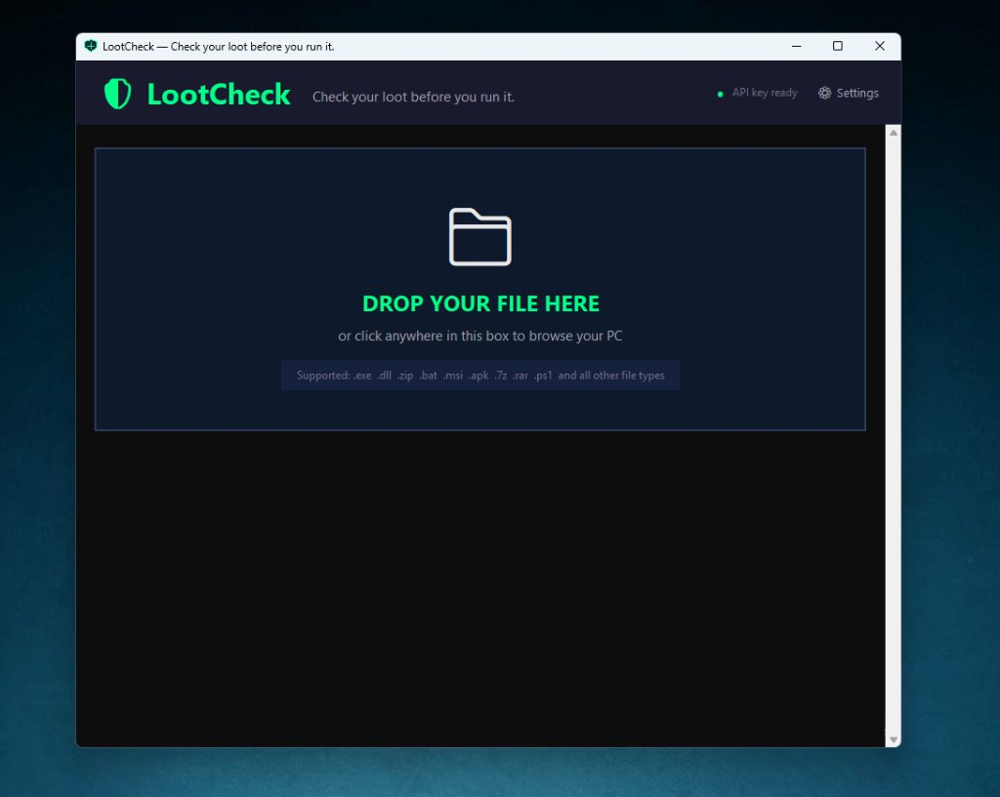

# 🛡️ LootCheck

> **"Check your loot before you run it."**  
> *Your last checkpoint before malware.*

<p align="center">
  
</p>

**LootCheck** is a dedicated, gamer-focused Windows desktop security utility that gives gamers a simple, intuitive, and visually responsive way to inspect files against VirusTotal before running them on their PC.

---

## 🎮 Why LootCheck?

Gamers frequently download mods, save editors, trainers, cheats, cracked executables, DLL injectors, and patches from unofficial sites and community boards. Because Windows Defender occasionally flags game mods with generic heuristics, many gamers completely disable Defender or add global folder exclusions—leaving their systems completely exposed to real stealers, ransomware, and remote access trojans (RATs).

**LootCheck** provides an essential safety net:
- **Drag file → Scan → Understand the risk in gamer terms → Decide what to do.**
- **Safe by design**: LootCheck **never** executes, runs, extracts, or modifies the scanned file.

---

## ✨ Features

- **Gaming-Inspired Dark UI**: Polished charcoal & neon interface designed like a modern utility rather than an outdated enterprise tool.
- **Spacious Drag & Drop Landing Pad**: Extra-large, responsive drop zone with generous surface area for dragging files directly from Windows Explorer (`.exe`, `.dll`, `.zip`, `.bat`, `.msi`, `.apk`, `.7z`, `.rar`, `.ps1`, etc.) or one-click file browsing.
- **⚡ 30-Second Automated Key Setup**:
  - **1-Click Key Portal**: Click **"⚡ Get Free API Key"** to open the VirusTotal registration/API portal directly in your browser.
  - **Instant Clipboard Paste**: Click **"📋 Paste from Clipboard"** to automatically sanitize, fill, save, and validate your key against VirusTotal in one single click.
  - **First-Launch Quick Setup Guide**: Intuitive banner displayed on launch to guide new users without any guesswork.
- **Genuine VirusTotal API v3**:
  - Immediate local SHA-256 calculation.
  - VirusTotal hash lookup without uploading.
  - Optional and consent-gated file uploading when a sample is unknown to VirusTotal.
  - Large file upload support (handles files up to 650 MB via VirusTotal's large-file endpoints).
- **Intelligent Risk Classification Engine**:
  - 🟢 **SAFE / NO THREATS DETECTED** (0 detections across all engines).
  - 🟡 **LOW RISK / POSSIBLE FALSE POSITIVE** (1–2 isolated detections, showing engine verdicts).
  - 🟠 **SUSPICIOUS / THIS FILE IS SUS** (Multiple flags; advises against running).
  - 🔴 **DANGEROUS / FINAL BOSS: MALWARE** (Heavy detections; red alert warning).
  - ⚪ **UNKNOWN / NO INTEL AVAILABLE** (File not yet in database; upload offered).
- **Collapsible Engine Breakdown**: View individual antivirus engine verdicts (Microsoft Defender, Kaspersky, CrowdStrike, SentinelOne, etc.) with color-coded tags.
- **Direct VirusTotal Web Reports**: One-click button to open the full analysis page on VirusTotal in your default browser.
- **Report Export**: Export clean forensic reports to **JSON** or **Plain Text** formats.
- **Secure Credential Storage**:
  - Securely stores your personal VirusTotal API key using **Windows Credential Manager** (`keyring`).
  - Fallback obfuscated storage if keyring is restricted.
  - Redacts API keys from all application logs and exported files.

---

## 🔒 Security Principles

1. **No Execution Guarantee**: LootCheck will **never** invoke, execute, launch shell commands with, or load scanned files as Python code.
2. **No Defender Tampering**: LootCheck **never** modifies Windows Defender settings, adds exclusions, or disables protection.
3. **Explicit Consent for Uploads**: Files are **never** uploaded automatically. Before submitting any new file to VirusTotal, an explicit privacy alert warns the user that uploaded files may be shared with security researchers.
4. **Key Safety**: Your VirusTotal API key is never hardcoded, never logged, and never included in exported reports or distribution builds.

---

## 🚀 Installation & Quick Start

### Running the Standalone Executable
1. Download `LootCheck.exe` from the `dist/` folder or GitHub Releases.
2. Double-click `LootCheck.exe` to run. No Python installation or runtime is needed.
3. **Set up your free key in 30 seconds**:
   - Click the **⚡ Set Up Free API Key** banner on the main screen (or click **⚙ Settings**).
   - Click **"⚡ Get Free API Key"** to open VirusTotal and grab your free key.
   - Click **"📋 Paste from Clipboard"** — LootCheck automatically validates and saves it.
4. Drag and drop any file into the large drop box and click **SCAN MY FILE**!

---

## 🛠️ Development & Building from Source

### Prerequisites
- **Windows 10 or 11** (64-bit recommended)
- **Python 3.10+** (Python 3.11, 3.12, 3.13, 3.15 supported)
- `pip` package manager

### Setup Instructions
1. Clone or copy this repository:
   ```cmd
   git clone https://github.com/lootcheck/lootcheck.git
   cd lootcheck
   ```

2. Create a virtual environment and activate it:
   ```cmd
   python -m venv .venv
   .venv\Scripts\activate
   ```

3. Install required packages:
   ```cmd
   pip install -r requirements.txt pillow
   ```

4. Run automated test suite:
   ```cmd
   pytest
   ```

5. Launch application from source:
   ```cmd
   python main.py
   ```

---

## 📦 Building the Windows Standalone Executable

To produce a single, self-contained `LootCheck.exe` with bundled icons and drag-and-drop libraries:

### Option 1: Automated Script
Run the included build script:
```cmd
build_windows.bat
```
This script will verify your Python environment, install dependencies, run the test suite, compile the icon, and build the PyInstaller executable.

### Option 2: Manual PyInstaller Command
```cmd
python generate_icon.py
pyinstaller --noconfirm --clean --windowed --onefile --name LootCheck --icon assets\icon.ico --add-data "assets;assets" main.py
```
The resulting executable will be placed in `dist\LootCheck.exe`.

---

## 🧪 Testing

The automated test suite covers:
- **SHA-256 Hashing**: Known hashes, empty files, binary chunks, large files, unicode paths, and progress callbacks.
- **Risk Classifier**: Zero detections, low risk, suspicious thresholds, high ratios, incomplete analysis, and custom thresholds.
- **File Validation**: File size formats, path sanitization, permission errors, empty files, and upload size checks.
- **VirusTotal API Client**: Mocked responses for hash lookup, file-not-found handling, rate limits (HTTP 429), upload flows, and analysis polling.
- **Report Generation**: JSON and TXT output integrity, disclaimer presence, and credential redaction.

Run all tests:
```cmd
pytest -v
```

---

## ⚠️ VirusTotal API & Security Disclaimers

> **IMPORTANT DISCLAIMER**:  
> VirusTotal is an aggregation service that runs files against dozens of independent antivirus engines.  
> - **Zero detections does NOT guarantee a file is 100% safe.** Brand new malware, targeted attacks, or crypters may not yet have signatures.
> - **A few detections may be false positives**, especially with game mods, trainers, or memory injectors that use hook APIs.
> - **Uploading samples**: Submitting a file to VirusTotal distributes that file to security researchers worldwide. **Do not upload confidential, personal, or proprietary files.**
> - **Free API Tier Limits**: The free VirusTotal public API allows **4 requests per minute** and **500 requests per day**. If you hit a rate limit, wait 60 seconds before scanning again.

---

## 📄 License

Distributed under the **MIT License**. See `LICENSE` for details.
